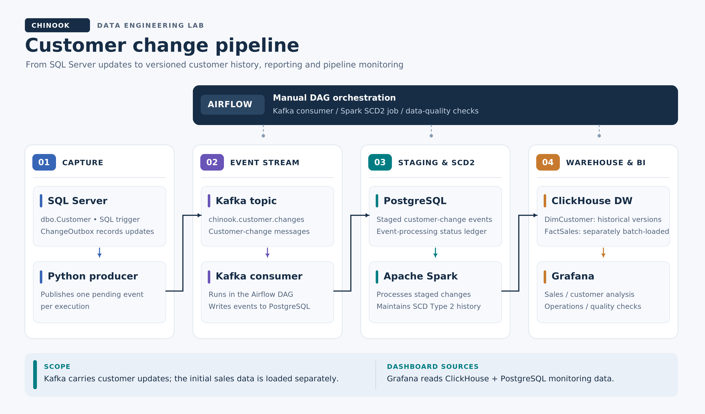
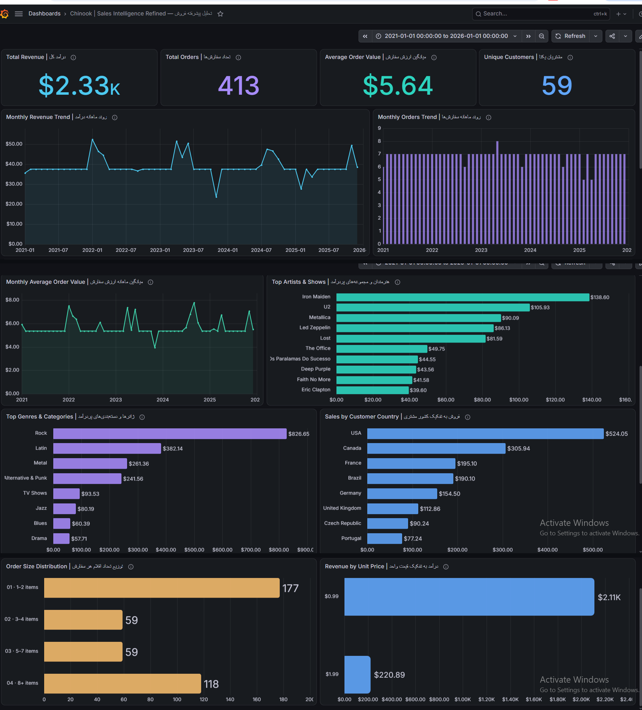
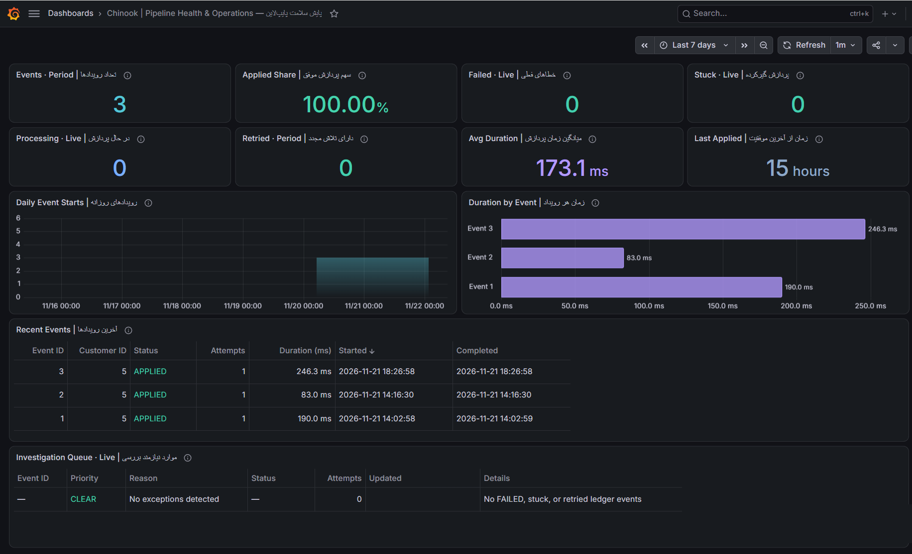
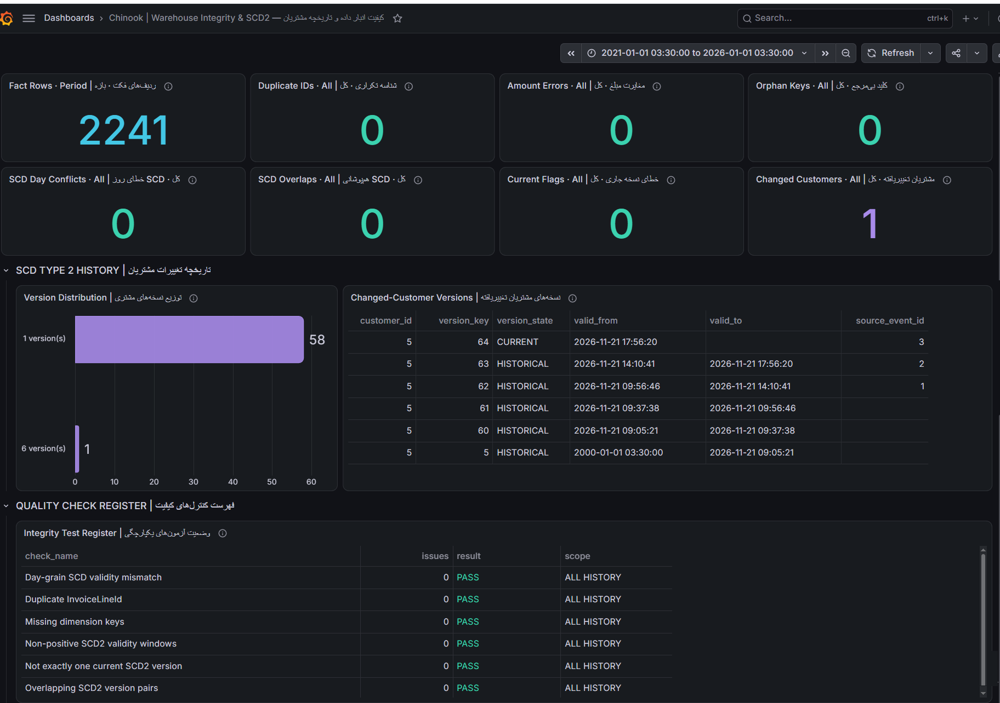

# Chinook Data Engineering Pipeline

**Tech stack:** SQL Server · Python · Kafka · PostgreSQL · Airflow · Spark · ClickHouse · Grafana · Docker

## English

A hands-on, end-to-end data engineering project using the Chinook dataset. Customer changes are captured in SQL Server and processed for analytics and monitoring.

**Pipeline:** SQL Server (Trigger + Outbox) → Python Producer → Kafka → Python Consumer → PostgreSQL (staging + ledger) → Airflow / Spark (SCD Type 2) → ClickHouse → Grafana.

**Highlights:** Customer change tracking, historical customer versions (SCD Type 2), a sales star schema, and checks for duplicates, broken references, amounts, and SCD history. Initial sales data is loaded separately from the Kafka CDC flow.

**Dashboards:** Sales Intelligence · Customers & Catalog · Pipeline Operations · Warehouse Quality. JSON exports are in `grafana/dashboards/`.

**Local setup:** Requires Docker/Compose, Python, and access to SQL Server. Configure private `.env` files, start the services, run the producer, and trigger the `chinook_cdc_to_warehouse` Airflow DAG. See [`docs/SETUP_FA.md`](docs/SETUP_FA.md). Never commit credentials.

**Status:** Core flow and sample events tested. Full automation, clean-install verification, and final recovery tests are pending. **Portfolio project; not production-ready.**

---

## فارسی

این پروژه یک پایپ‌لاین عملی مهندسی داده با دیتاست Chinook است. تغییرات مشتریان در SQL Server ثبت و پس از انتقال و پردازش، برای تحلیل و مانیتورینگ آماده می‌شوند.

**مسیر داده:** SQL Server (Trigger + Outbox) → Python → Kafka → PostgreSQL → Airflow / Spark (SCD Type 2) → ClickHouse → Grafana.

**قابلیت‌ها:** ثبت تغییرات مشتری، نگهداری تاریخچه با SCD Type 2، مدل ستاره‌ای فروش و کنترل کیفیت داده (تکراری‌ها، کلیدهای نامعتبر، اختلاف مبلغ و تاریخچه). بارگذاری اولیه فروش جدا از مسیر Kafka انجام شده است.

**داشبوردها:** تحلیل فروش، مشتریان و محصولات، مانیتورینگ پایپ‌لاین و کیفیت انبار داده. فایل‌ها در `grafana/dashboards/` هستند.

**راه‌اندازی:** Docker/Compose، Python و دسترسی به SQL Server لازم است. فایل‌های `.env` شخصی را تنظیم کنید، سرویس‌ها و Producer را اجرا کنید و DAG با نام `chinook_cdc_to_warehouse` را در Airflow اجرا کنید. راهنمای فعلی: [`docs/SETUP_FA.md`](docs/SETUP_FA.md). رمزها را وارد Git نکنید.

**وضعیت:** بخش‌های اصلی و رویدادهای آزمایشی تست شده‌اند؛ خودکارسازی کامل، نصب از صفر و تست نهایی بازیابی هنوز باقی مانده است. **پروژه نمونه‌کار است، نه سرویس آماده Production.**

<!-- chinook-visuals -->

## Architecture | معماری پروژه

The pipeline processes customer changes through Kafka, PostgreSQL, and Spark, then maintains customer history in ClickHouse using SCD Type 2. Airflow orchestrates the processing steps, and Grafana provides analytics and monitoring.

مسیر تغییرات مشتریان از SQL Server شروع می‌شود و با استفاده از Kafka، PostgreSQL و Spark به ClickHouse می‌رسد. تاریخچه مشتریان با SCD Type 2 نگهداری می‌شود و Grafana برای تحلیل و مانیتورینگ استفاده شده است.

## Dashboards | داشبوردها

Four Grafana dashboards were created to explore sales data and monitor the pipeline and warehouse.

چهار داشبورد برای تحلیل فروش، بررسی مشتریان، مانیتورینگ پردازش‌ها و کنترل کیفیت داده طراحی شده‌اند.

### Sales Intelligence | تحلیل فروش

Revenue, orders, customer activity, and sales trends.

درآمد، سفارش‌ها، مشتریان و روند فروش.

<b>Customers & Catalog | تحلیل مشتریان و کاتالوگ</b>

Customer activity, buying patterns, and catalog performance.

تحلیل رفتار خرید مشتریان و عملکرد محصولات.

<b>Pipeline Health & Operations | مانیتورینگ پایپ‌لاین</b>

Event-processing status, execution duration, and operational monitoring.

وضعیت رویدادها، زمان پردازش و بررسی عملکرد پایپ‌لاین.

<b>Warehouse Integrity & SCD2 | کیفیت انبار داده</b>

Data integrity checks and customer history maintained with SCD Type 2.

کنترل کیفیت داده و بررسی تاریخچه تغییرات مشتریان.

