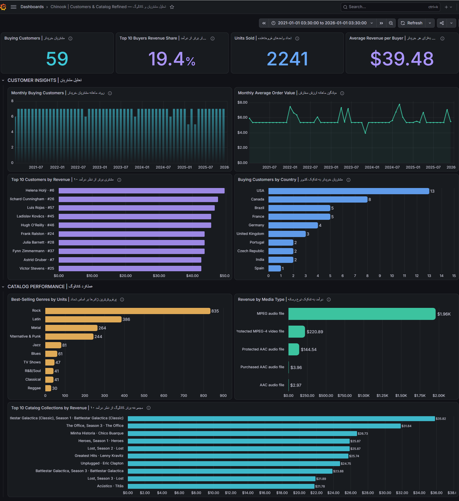

# Chinook Data Engineering Pipeline

**Tools:** SQL Server · Python · Kafka · PostgreSQL · Airflow · Spark · ClickHouse · Grafana · Docker

## English

I worked on this project using the Chinook sample database to practice handling changes to customer records in a data warehouse. The main part is a small pipeline that takes customer updates from SQL Server and keeps previous versions instead of replacing them. I also added sales reports and dashboards to check the results and follow the processing steps.

**How the data moves:** A trigger records customer updates in `dbo.ChangeOutbox` in SQL Server. A Python producer sends those events to Kafka, and a consumer writes them to PostgreSQL staging. Airflow runs the processing steps, including a Spark job that updates `DimCustomer` in ClickHouse using SCD Type 2. Grafana reads the warehouse and monitoring data to display the results.

The Kafka flow handles **customer changes**. The original sales data was loaded separately into the warehouse.

**What I tested:** After working through several updates for `CustomerId = 5`, `DimCustomer` contains six versions of that customer: five historical records and one current record. The processing ledger shows three applied change events. The sales fact table contains 2,241 invoice-line rows. These are local test results using the Chinook dataset.

**Running it locally:** I used Windows with WSL2 Ubuntu and Docker Compose, with SQL Server running on Windows. The setup notes are in [docs/SETUP_FA.md](docs/SETUP_FA.md), and the Grafana dashboard JSON files are in [grafana/dashboards](grafana/dashboards/).

**Current limitations:** The producer publishes one pending event per run, and the main Airflow DAG is triggered manually. I have not finished a clean installation test or the full failure-and-recovery scenarios. This repository is a learning and portfolio project, not a production deployment.

---

## فارسی

این پروژه را با دیتاست نمونه Chinook کار کردم تا انتقال تغییرات اطلاعات مشتریان به انبار داده را تمرین کنم. بخش اصلی پروژه یک پایپ‌لاین است که تغییرات مشتری را از SQL Server می‌گیرد و به‌جای جایگزین‌کردن اطلاعات قبلی، نسخه‌های مختلف آن را نگه می‌دارد. در ادامه، گزارش‌های فروش و داشبوردهایی هم اضافه کردم تا هم خروجی داده‌ها را ببینم و هم وضعیت پردازش را بررسی کنم.

**مسیر داده:** تغییرات مشتری با Trigger در جدول `dbo.ChangeOutbox` در SQL Server ثبت می‌شوند. Producer پایتون آن‌ها را به Kafka می‌فرستد و Consumer رویدادها را در PostgreSQL ذخیره می‌کند. Airflow مراحل پردازش را اجرا می‌کند و Spark با روش SCD Type 2 تغییرات را روی `DimCustomer` در ClickHouse اعمال می‌کند. Grafana هم برای نمایش گزارش‌ها و وضعیت پایپ‌لاین استفاده شده است.

مسیر Kafka فقط برای **تغییرات مشتریان** است و داده‌های اولیه فروش جداگانه به انبار داده منتقل شده‌اند.

**نتیجه آزمایش‌ها:** برای مشتری شماره `5` چند تغییر را بررسی کردم. در پایان، شش نسخه از این مشتری در `DimCustomer` وجود دارد؛ پنج نسخه تاریخی و یک نسخه فعلی. در جدول وضعیت پردازش هم سه رویداد با وضعیت `APPLIED` ثبت شده و جدول فروش `FactSales` شامل ۲۲۴۱ ردیف است. این اعداد نتیجه آزمایش روی داده‌های Chinook هستند.

**اجرای پروژه:** محیط کار من Windows و WSL2 Ubuntu بوده و سرویس‌ها را با Docker Compose اجرا کردم؛ SQL Server روی Windows قرار دارد. توضیحات راه‌اندازی در [docs/SETUP_FA.md](docs/SETUP_FA.md) و فایل‌های داشبورد در [grafana/dashboards](grafana/dashboards/) هستند.

**وضعیت فعلی:** Producer در هر اجرا یک رویداد در انتظار را ارسال می‌کند و DAG اصلی Airflow دستی اجرا می‌شود. تست نصب کامل از صفر و سناریوهای نهایی خطا و بازیابی هنوز باقی مانده‌اند. این مخزن یک پروژه عملی و نمونه‌کار است، نه سرویس آماده استفاده در محیط عملیاتی.

---

## Architecture | معماری پروژه

Customer updates move through the pipeline into versioned warehouse records. Airflow coordinates processing; Grafana provides reporting and monitoring.

تغییرات مشتریان در پایپ‌لاین پردازش می‌شوند و در انبار داده همراه با تاریخچه‌شان نگهداری می‌شوند. Airflow اجرای مراحل را مدیریت می‌کند و Grafana خروجی‌ها را نشان می‌دهد.

## Dashboards | داشبوردها

Four dashboards cover sales, customers and catalog, event processing, and warehouse checks.

چهار داشبورد برای تحلیل فروش، مشتریان و کاتالوگ، وضعیت پردازش رویدادها و کنترل‌های انبار داده آماده شده‌اند.

### Sales Intelligence | تحلیل فروش

Sales KPIs and trends across the Chinook dataset. / شاخص‌ها و روندهای فروش در دیتاست Chinook.

### Customers & Catalog | تحلیل مشتریان و کاتالوگ

Customer activity, buying patterns, and catalog results. / رفتار خرید مشتریان و عملکرد کاتالوگ.

### Pipeline Health & Operations | مانیتورینگ پایپ‌لاین

Processed events, duration, and investigation queue. / وضعیت رویدادها، زمان پردازش و موارد نیازمند بررسی.

### Warehouse Integrity & SCD2 | کیفیت انبار داده

Data integrity checks and customer version history. / کنترل کیفیت داده و تاریخچه نسخه‌های مشتریان.

